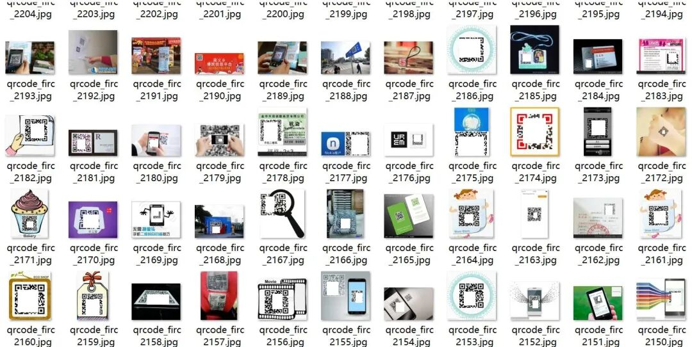
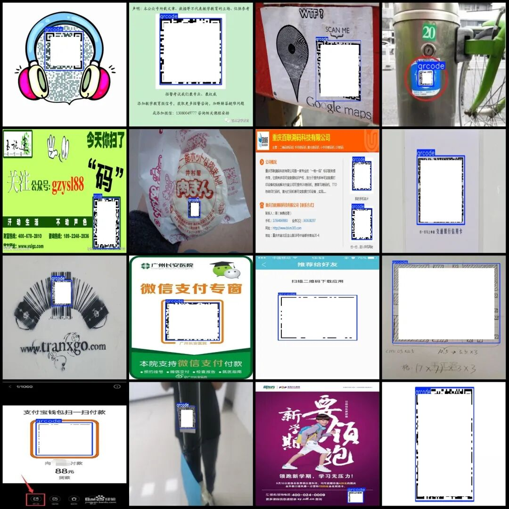

# VOC+YOLO format 2483 images with 1 category

Dataset format: Pascal VOC format + YOLO format (txt file without split path, only containing jpg images and corresponding VOC format xml files and yolo format txt files)

Number of images (number of jpg files): 2483

Number of annotations (number of xml files): 2483

Number of annotations (number of txt files): 2483

Label category count: 1

Label category name (Note that the order of categories in the YOLO format does not correspond to this, but is based on the classes.txt file in the labels folder): ["qrcode"]

Number of boxes labeled in each category:

QR Code Frame Count = 3784

Total frame count: 3784

Using labelImg:

Annotation rules: Draw a rectangle around the category.

Important Notice: No

Special : This dataset does not guarantee the accuracy or precision of the trained models or weight files. The dataset is provided with accurate and reasonable annotations only.

Preview of the image (to prevent platforms from claiming it as a promotional advertisement or similar QR code has been processed):

Annotation Example (to prevent the platform from classifying as promotional advertisements or similar):

## Payment

Here is a pay link on Stripe ( https://buy.stripe.com/3cs8yP7sY87d0vu9AB ). Please contact me lonlonago@foxmail.com after funding $89, and I will send you a complete data files , thank you!

